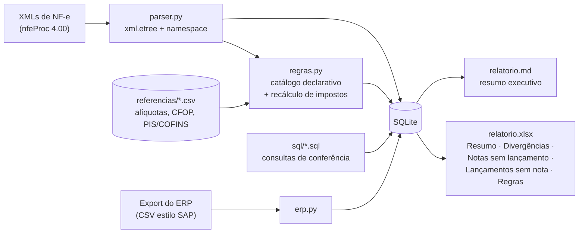

# conferencia-fiscal-nfe

**Robô de conferência fiscal de entrada: lê os XMLs de NF-e, recalcula ICMS, IPI, PIS e COFINS, aplica regras fiscais e cruza tudo com o que foi lançado no ERP. Entrega uma planilha pronta para o fiscal agir.**


## O problema

No fechamento, alguém do fiscal abre nota por nota e confere no olho: o CFOP bate com a operação? A alíquota interestadual está certa para essa UF? A base do ICMS fecha com o valor do item? PIS/COFINS na alíquota do regime? A soma dos itens fecha com o total? Depois vai ao ERP conferir se a nota foi lançada, se foi lançada duas vezes, se o valor digitado é o do XML.

É trabalho repetitivo e baseado em regras, ou seja, é trabalho para robô. O erro que passa vira crédito de ICMS glosado, pagamento em dobro ou nota que só aparece na malha fina.

## O que o robô faz



1. **Lê** cada XML (com ou sem `nfeProc`), respeitando o namespace `http://www.portalfiscal.inf.br/nfe`, com valores em `Decimal`.
2. **Valida** com 15 regras de XML: DV da chave de acesso (módulo 11), chave × dados da nota, DV do CNPJ (inclusive o **alfanumérico**, vigente desde julho/2026), NCM, CFOP 5xxx × 6xxx, alíquota interestadual 4/7/12 %, base e valor do ICMS (com redução do CST 20), CRT × CST/CSOSN, IPI, par de alíquotas PIS/COFINS, valor de PIS/COFINS, soma dos itens × `ICMSTot` e nota duplicada no lote.
3. **Cruza com o ERP em SQL** (SQLite): nota sem lançamento, lançamento sem XML, lançamento em duplicidade, valor divergente e ICMS divergente. As consultas estão em [`src/nfe_conf/sql/`](src/nfe_conf/sql/), em arquivos `.sql` legíveis.
4. **Entrega** uma planilha Excel com filtro, cabeçalho fixo e cor por severidade, e um relatório executivo em Markdown.

## Como rodar (2 comandos)

Com Python 3.12+ e um ambiente virtual ativo (`python -m venv .venv` e depois `.venv\Scripts\activate` no Windows ou `source .venv/bin/activate` no Linux/macOS):

```bash
pip install -e .
nfe-conf conferir --xml exemplos/xml --erp exemplos/erp_lancamentos.csv --saida saida/relatorio.xlsx
```

Outros comandos:

```bash
nfe-conf gerar-exemplo --destino exemplos      # recria o lote fictício (mesma semente = mesmo lote)
nfe-conf regras                                # lista o catálogo de regras
nfe-conf conferir ... --db saida/base.sqlite   # guarda a base SQLite para consultar depois
nfe-conf conferir ... --falhar-se-alta         # sai com código 1 se houver divergência ALTA (agendamento)
```

## Resultado no lote de exemplo

O lote em [`exemplos/`](exemplos/) tem **60 XMLs** (58 notas + 2 cópias) de 9 fornecedores fictícios em 7 UFs, todos vendendo para um destinatário em GO, e um export do ERP com **58 lançamentos**. O gerador plantou **32 divergências** de propósito e as registrou em [`exemplos/gabarito.json`](exemplos/gabarito.json).

Saída real da CLI:

```text
60 XMLs lidos | 58 notas únicas | 58 lançamentos no ERP
32 divergências (ALTA: 23, MÉDIA: 9)
  ERP_NAO_LANCADA              4
  ERP_VALOR_DIVERGENTE         3
  ICMS_ALIQ_INTERESTADUAL      3
  ICMS_BASE                    3
  CFOP_OPERACAO                3
  PIS_COFINS_ALIQUOTA          3
  CHAVE_DV                     2
  ERP_DUPLICIDADE              2
  ERP_SEM_XML                  2
  NOTA_DUPLICADA               2
  TOTAL_NOTA                   2
  NCM_INVALIDO                 2
  ERP_ICMS_DIVERGENTE          1
Planilha: saida\relatorio.xlsx
Relatório executivo: saida\relatorio.md
```

**32 plantadas, 32 encontradas, zero falsos positivos.** Isso não é só uma afirmação do README: o teste `test_motor_acha_exatamente_o_que_foi_plantado` compara o resultado com o gabarito a cada execução do CI.

Linhas reais da aba *Divergências* (colunas resumidas):

| Sev. | Regra | NF | Emitente | Mensagem | Esperado | Encontrado |
|---|---|---|---|---|---|---|
| ALTA | `ICMS_ALIQ_INTERESTADUAL` | 79778 | Metalúrgica Horizonte Fictícia | SP→GO, origem 1: alíquota 12.00% | 4.00% | 12.00% |
| ALTA | `ICMS_ALIQ_INTERESTADUAL` | 65335 | Embalagens Capibaribe Fictícia | PE→GO, origem 0: alíquota 7.00% | 12.00% | 7.00% |
| ALTA | `TOTAL_NOTA` | 50328 | Papelaria Ipê Fictícia | Total divergente em vProd, vNF | vProd=2036.00; vNF=2036.00 | vProd=2186.00; vNF=2186.00 |
| ALTA | `ERP_VALOR_DIVERGENTE` | 45616 | Móveis Anápolis Fictícia | Doc. 5100004035: diferença de 3358.26 | 373.14 | 3731.40 |
| ALTA | `CHAVE_DV` | 33994 | Atacadista Cerrado Fictício | Chave 5226…9877 não passa no módulo 11 | DV 6 | DV 7 |
| MÉDIA | `CFOP_OPERACAO` | 38728 | Química Recôncavo Fictícia | Operação interestadual (BA→GO) com CFOP 5102 | 6xxx | 5102 |

## Catálogo de regras

Cada regra é declarada uma vez com **código, severidade, descrição e como corrigir**. Esse texto vai para a planilha (aba *Regras*), para o relatório executivo e para a tabela `regras` do SQLite. Criar uma regra nova é escrever uma função e decorá-la:

```python
@regra(
    "ICMS_VALOR",
    Severidade.ALTA,
    "Valor do ICMS diferente de base × alíquota",
    "Creditar o valor recalculado; se o destaque estiver a maior, solicitar ajuste ao fornecedor.",
    "item",
)
def icms_valor(item, nota, tabelas):
    if item.icms_cst not in CSTS_COM_ICMS_PROPRIO:
        return
    esperado = arredondar(item.icms_base * item.icms_aliquota / 100)
    if _diferente(item.icms_valor, esperado):
        yield Achado("vICMS ≠ vBC × pICMS", _fmt(esperado), _fmt(item.icms_valor), item.n_item)
```

| Código | Sev. | Escopo | O que confere |
|---|---|---|---|
| `CHAVE_DV` | ALTA | nota | DV da chave de acesso (módulo 11) |
| `CHAVE_CAMPOS` | MÉDIA | nota | cUF, CNPJ, modelo, série e número da chave × `<ide>`/`<emit>` |
| `CNPJ_EMITENTE_DV` | ALTA | nota | DV do CNPJ do emitente (numérico ou alfanumérico) |
| `NCM_INVALIDO` | MÉDIA | item | 8 dígitos, capítulo 01–97, exceto 77 |
| `CFOP_OPERACAO` | MÉDIA | item | 5xxx na operação interna, 6xxx na interestadual |
| `ICMS_ALIQ_INTERESTADUAL` | ALTA | item | 4 % (importado), 7 % ou 12 % conforme origem e destino |
| `ICMS_BASE` | ALTA | item | vBC = vProd − vDesc (com pRedBC no CST 20) |
| `ICMS_VALOR` | ALTA | item | vICMS = vBC × pICMS |
| `ICMS_REGIME` | MÉDIA | item | CRT 1 usa CSOSN; CRT 3 usa CST; CSOSN 102 sem destaque |
| `IPI_VALOR` | MÉDIA | item | vIPI = vBC × pIPI |
| `PIS_COFINS_ALIQUOTA` | MÉDIA | item | par 0,65/3,00 (cumulativo) ou 1,65/7,60 (não cumulativo) |
| `PIS_COFINS_VALOR` | MÉDIA | item | vPIS e vCOFINS = vBC × alíquota |
| `TOTAL_NOTA` | ALTA | nota | soma dos itens × vProd, vDesc, vBC, vICMS, vST, vIPI, vPIS, vCOFINS, vNF |
| `NOTA_DUPLICADA` | ALTA | lote | mesma chave em mais de um arquivo |
| `XML_ILEGIVEL` | ALTA | arquivo | XML malformado ou sem `infNFe` |
| `ERP_NAO_LANCADA` | ALTA | erp (SQL) | [`notas_sem_lancamento.sql`](src/nfe_conf/sql/notas_sem_lancamento.sql) |
| `ERP_SEM_XML` | ALTA | erp (SQL) | [`lancamentos_sem_nota.sql`](src/nfe_conf/sql/lancamentos_sem_nota.sql) |
| `ERP_DUPLICIDADE` | ALTA | erp (SQL) | [`lancamentos_duplicados.sql`](src/nfe_conf/sql/lancamentos_duplicados.sql) |
| `ERP_VALOR_DIVERGENTE` | ALTA | erp (SQL) | [`valor_divergente.sql`](src/nfe_conf/sql/valor_divergente.sql) |
| `ERP_ICMS_DIVERGENTE` | MÉDIA | erp (SQL) | [`icms_divergente.sql`](src/nfe_conf/sql/icms_divergente.sql) |

## Tabelas de referência

Ficam em [`src/nfe_conf/referencias/`](src/nfe_conf/referencias/), em CSV, para o fiscal revisar sem abrir Python:

| Arquivo | Conteúdo | Fonte |
|---|---|---|
| `aliquotas_interestaduais.csv` | matriz 27 × 27 de alíquota por UF de origem/destino (7 % ou 12 %) | Resolução do Senado Federal 22/1989 |
| `origem_mercadoria.csv` | origens 0–8; quais levam 4 % | Resolução do Senado Federal 13/2012 |
| `ufs.csv` | código IBGE (cUF), região, grupo Sul/Sudeste exceto ES | IBGE |
| `cfop_grupos.csv` | 1º dígito do CFOP: entrada/saída, estadual/interestadual/exterior | Convênio s/nº de 1970 (tabela CFOP) |
| `pis_cofins.csv` | 0,65/3,00 cumulativo; 1,65/7,60 não cumulativo | Leis 9.718/1998, 10.637/2002 e 10.833/2003 |

> **São simplificações didáticas.** Servem para demonstrar a técnica (regra fiscal como dado versionado, conferida por código testado), não para substituir a análise do fiscal nem a legislação vigente.

## Decisões

- **Dinheiro em `Decimal` no Python e em centavos (`INTEGER`) no SQLite.** Comparar `float` em conferência fiscal dá falso positivo de R$ 0,01. Tolerância explícita de 1 centavo nos recálculos.
- **Regra é dado + função pequena.** Código, severidade, descrição e correção ficam juntos; o motor descobre as regras sozinho; o relatório lê o mesmo catálogo.
- **SQL em arquivos `.sql`, não em strings no Python.** O cruzamento XML × ERP é um `LEFT JOIN`/`GROUP BY` que qualquer analista lê e roda no DBeaver.
- **A chave do cruzamento é CNPJ do emitente + número + série**, porque é isso que o ERP guarda; a chave de acesso nem sempre é digitada no lançamento.
- **Cópias de XML não contam em dobro**: a duplicidade é apontada uma vez (`NOTA_DUPLICADA`) e as outras regras rodam só na primeira ocorrência.
- **Gerador com gabarito.** Os dados de teste são gerados com semente fixa, e cada erro plantado vai para `gabarito.json`. O teste de ponta a ponta mede recall e precisão, e não apenas se o programa terminou sem erro.
- **Só biblioteca padrão para XML** (`xml.etree`). Única dependência de execução: `openpyxl`.
- **Sem IA/LLM.** Conferência fiscal é determinística: a mesma nota tem de dar sempre o mesmo resultado, e o resultado tem de ser explicável linha a linha.

## Limites (o que fica de fora)

- **ICMS-ST completo**: MVA, pauta, protocolos e convênios entre UFs, ressarcimento. O motor lê vBCST/vICMSST e soma no total, mas não valida o cálculo da ST.
- **DIFAL e FCP**, inclusive na entrada para uso e consumo ou ativo imobilizado.
- **Benefícios fiscais**: redução de base, isenção, diferimento e crédito presumido por UF. No CST 20 o motor aceita o `pRedBC` informado e só confere a conta.
- **Alíquota interna**: operações dentro do estado não têm a alíquota conferida.
- **Base do ICMS** simplificada (vProd − vDesc), sem frete, seguro e outras despesas rateados por item e sem IPI na base (que entra quando a mercadoria é para uso e consumo).
- **PIS/COFINS**: confere o par de alíquotas e a conta, não o regime real do fornecedor (o XML não diz se é lucro real ou presumido), nem monofásico, alíquota zero ou a exclusão do ICMS da base.
- **NCM**: só o formato; não consulta a TIPI.
- **Sem validação de schema XSD, assinatura digital ou situação na SEFAZ** (cancelada, denegada). Os XMLs de exemplo não são assinados.
- **Chave de acesso com CNPJ alfanumérico** ainda não é tratada (o DV do CNPJ alfanumérico é).
- **Reforma tributária**: os grupos de IBS/CBS do layout novo não são lidos.

## Dados fictícios

Todas as empresas, inscrições estaduais, produtos e valores são inventados. Os CNPJs são **sorteados** com dígito verificador válido; qualquer coincidência com um CNPJ real é acidental. As notas saem com `tpAmb=2` (homologação) e destinatário "NF-E EMITIDA EM AMBIENTE DE HOMOLOGACAO - SEM VALOR FISCAL", como a SEFAZ exige em notas de teste.

## Estrutura

```text
src/nfe_conf/
├── cli.py               # nfe-conf conferir | gerar-exemplo | regras
├── parser.py            # XML NF-e 4.00 -> modelo
├── regras.py            # catálogo declarativo de regras
├── motor.py             # orquestra: XML -> regras -> SQLite -> cruzamento ERP
├── banco.py             # carga no SQLite e execução dos .sql
├── erp.py               # leitura do CSV do ERP (padrão brasileiro: 1.234,56; dd.mm.aaaa)
├── dv.py                # DV de CNPJ (numérico e alfanumérico) e da chave de acesso
├── tabelas.py           # carrega referencias/*.csv
├── gerador.py           # lote fictício + export do ERP + gabarito
├── relatorio_excel.py   # planilha openpyxl
├── relatorio_md.py      # resumo executivo
├── referencias/*.csv
└── sql/*.sql
tests/                   # 82 testes (pytest)
exemplos/                # 60 XMLs, erp_lancamentos.csv, gabarito.json
```

## Desenvolvimento

```bash
pip install -e ".[dev]"
ruff check .
pytest
```

O GitHub Actions roda lint, testes e a conferência de ponta a ponta no lote de exemplo a cada push.

## Licença

MIT. Projeto pessoal de portfólio.
